<div align="center">


<a href="https://github.com/RajdipDhar2007/AttendTrack">
  
</a>

<br/>


**[Features](#-features) · [Screenshots](#-screenshots) · [Install](#-install-in-60-seconds) · [Build](#%EF%B8%8F-build-from-source) · [How it works](#-how-the-math-works)**

</div>

---

## 🎯 Why AttendTrack?

> *"Can I skip tomorrow's class?"*  AttendTrack answers that, instantly, with real math.

| 😩 Without it | 😎 With AttendTrack |
|---|---|
| Guessing your percentage | Live, animated percentage per subject |
| Panicking before exams | Exact number of classes needed to recover |
| Forgetting to mark classes | Smart reminders with one-tap actions |
| Messy notebooks | Timetable, exams and study plans in one place |

## 📸 Screenshots

<div align="center">

| Dashboard | Subjects: All Classes | Subjects: Theory |
|:---:|:---:|:---:|
| 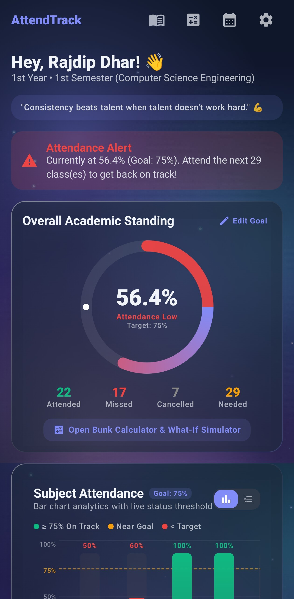 | 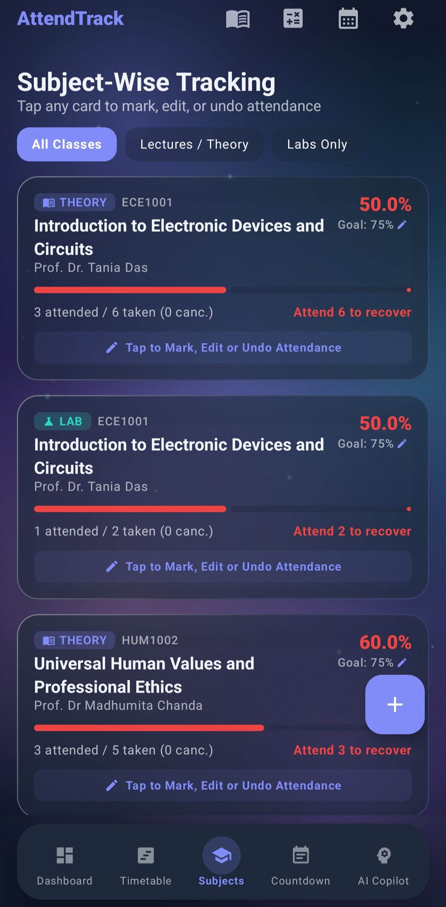 | 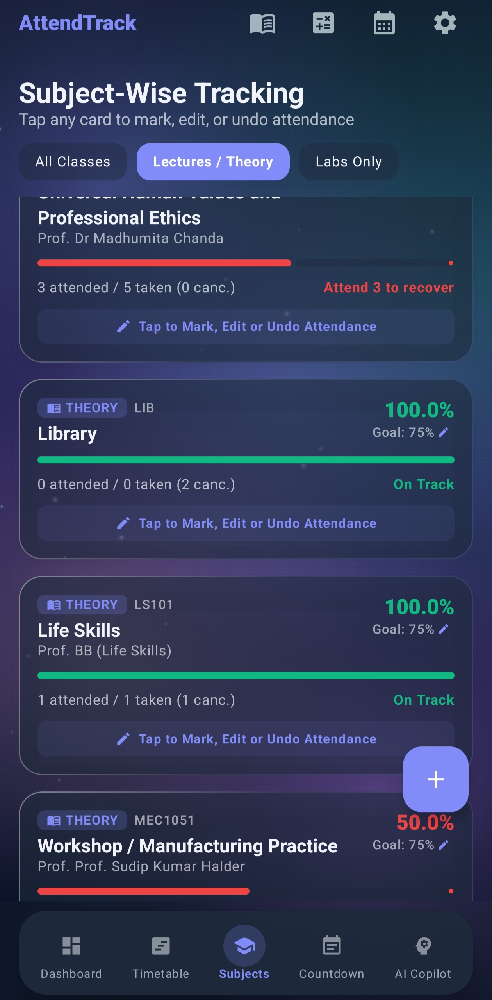 |

| Subjects: Labs Only | Monthly | Backfill |
|:---:|:---:|:---:|
| 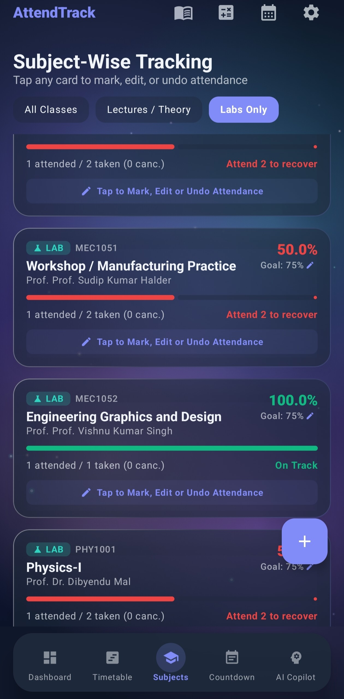 | 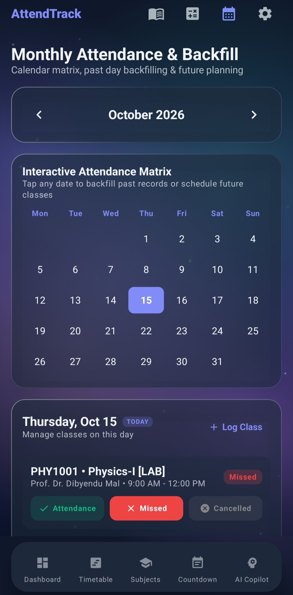 | 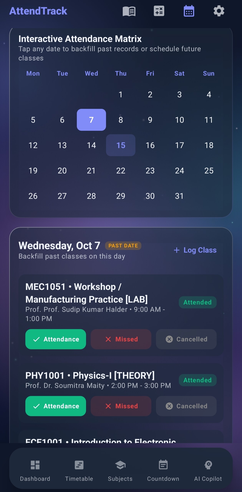 |

| Bunk Calculator | Timetable (Thu) | Timetable (Wed) |
|:---:|:---:|:---:|
| 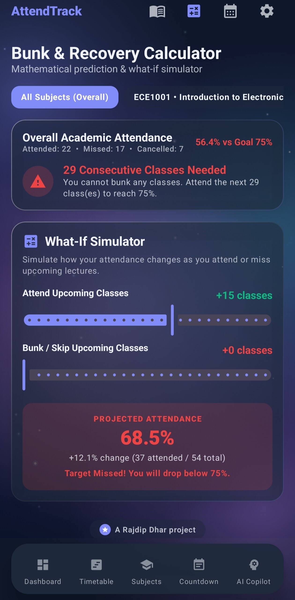 | 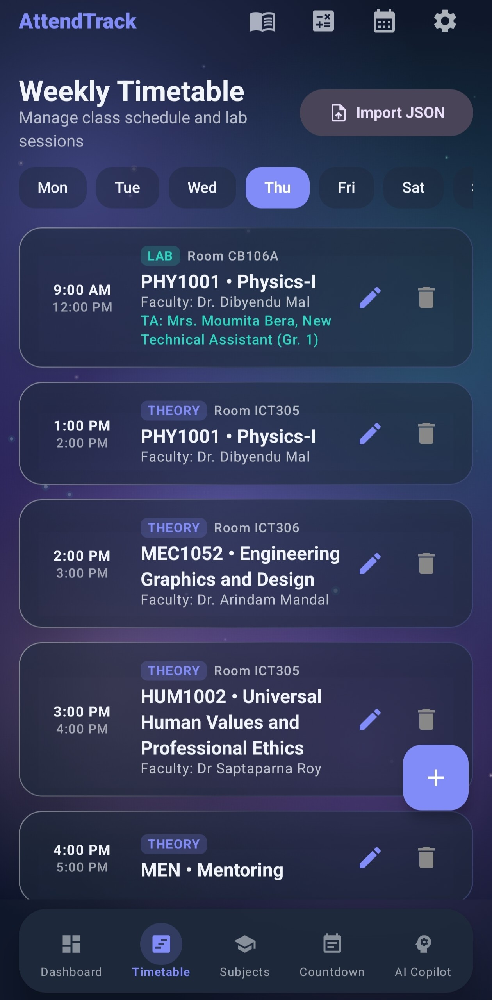 | 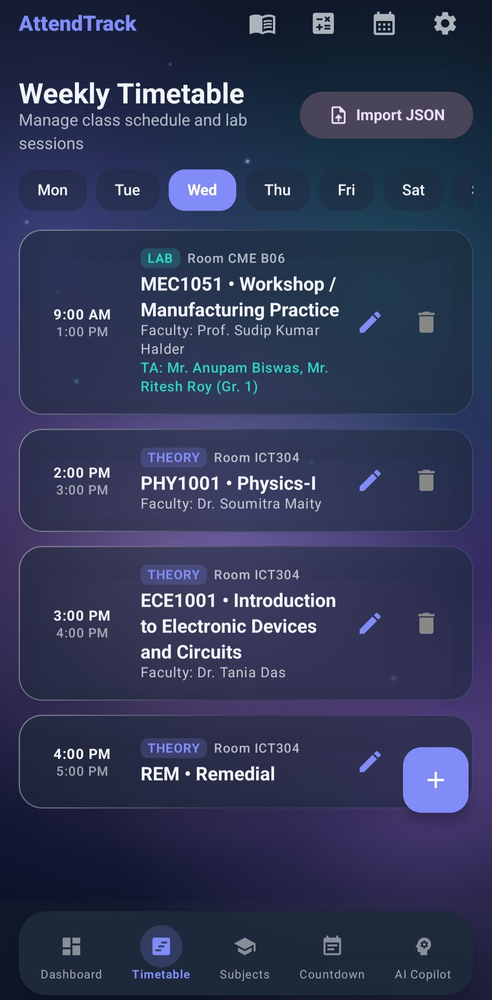 |

| Study Planner | Exam Countdown | Themes |
|:---:|:---:|:---:|
| 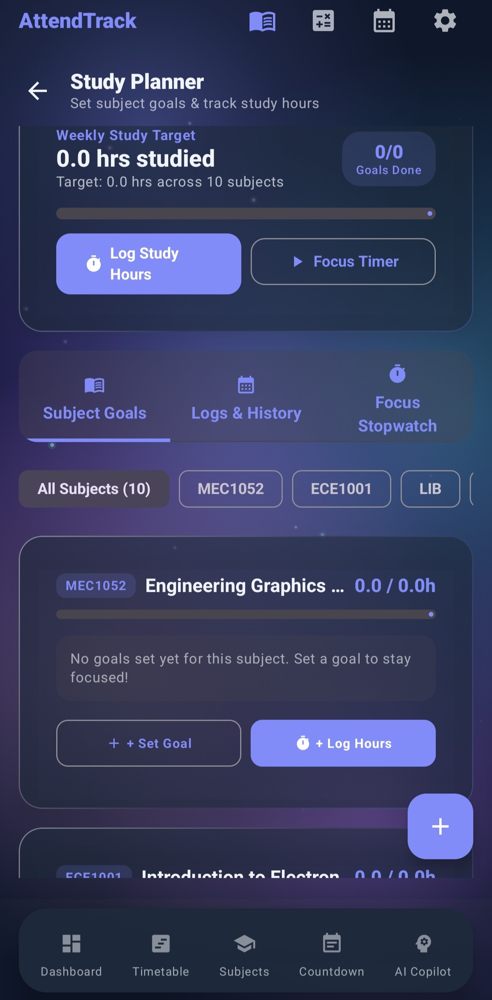 | 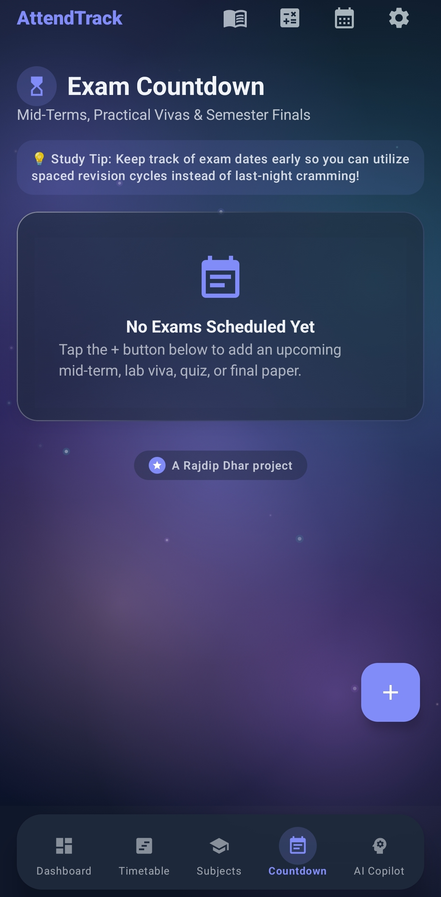 | 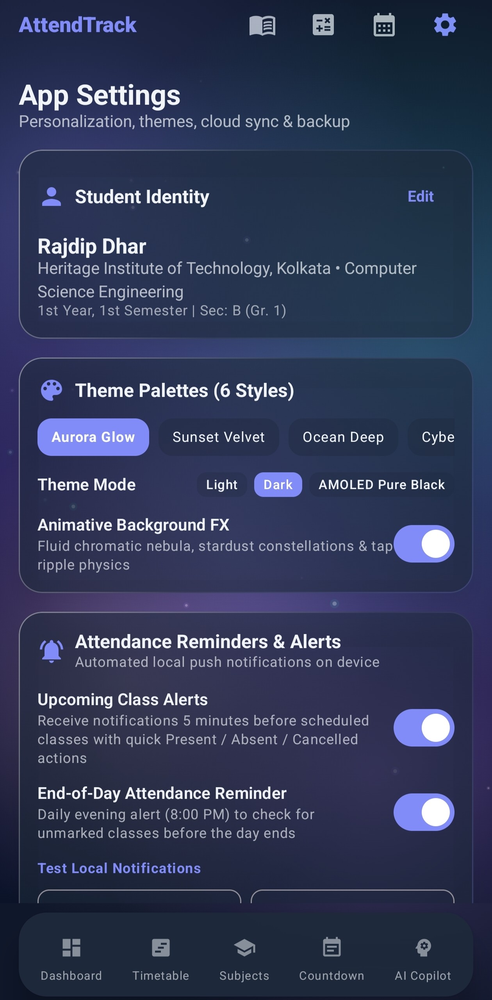 |

| AI Copilot | AI Copilot: Faculty | Import / Export |
|:---:|:---:|:---:|
| 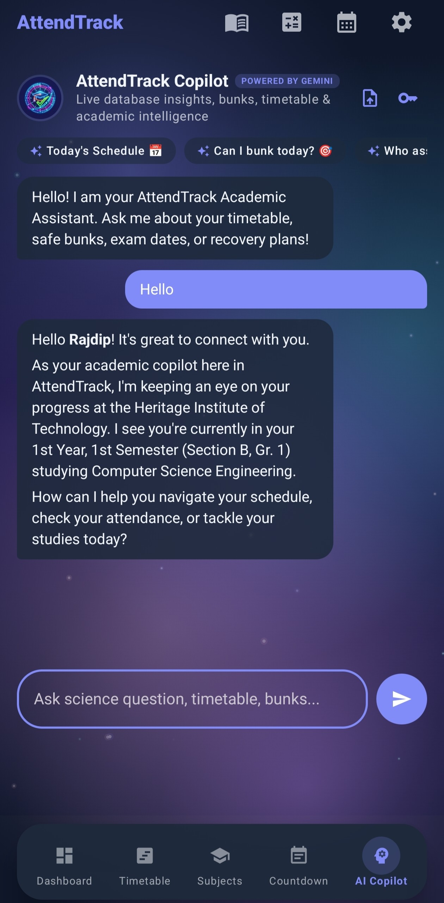 | 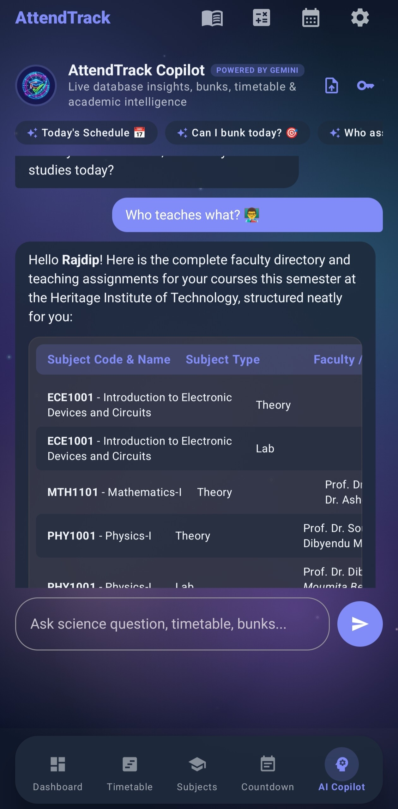 | 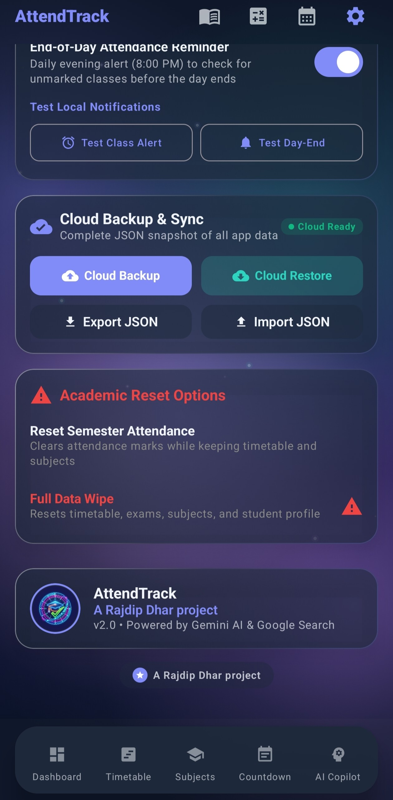 |

<sub>More details on each image in <a href="docs/screenshots">docs/screenshots</a>.</sub>

</div>

## ✨ Features

<table>
<tr>
<td width="50%" valign="top">

### 📊 Attendance
- Dashboard with a percentage ring and streaks
- **One tap**: Attended · Missed · Cancelled
- Subjects screen filters: **All Classes**, **Lectures / Theory** and **Labs Only**
- A subject with both lectures and labs gets a separate card (and percentage) for each
- Cancelled classes and holidays never hurt your %

### 🗓️ Monthly & Backfill
- Interactive month calendar
- Backfill past days, plan future ones
- Log ad-hoc classes on any date
- Semester Subject Distribution with live bars

</td>
<td width="50%" valign="top">

### 🧮 Bunk & Recovery Calculator
- Safe bunks available right now
- Classes you must attend to hit your goal
- **What-If Simulator**: slide attend/skip and watch the result animate

### 📚 Academics
- Weekly timetable with teachers, rooms and labs
- Exam countdown and scheduler
- Study planner with goals and sessions
- **AI Copilot (Gemini)** that sees your attendance, timetable and faculty

</td>
</tr>
</table>

### 🎨 Built to be addictive

| | |
|---|---|
| 🫧 **Springy buttons** | Every press squishes and bounces back with a haptic tick |
| 🌊 **Cascading cards** | Cards fade and slide in one after another |
| 🔢 **Counting numbers** | Percentages roll up to their new value |
| 📶 **Living progress bars** | Bars grow with a bounce and change color at your target |
| 🎆 **Confetti** | Celebrate when you hit your goal |
| 🌈 **6 palettes** | Aurora Glow · Sunset Velvet · Ocean Deep · Cyber Neon · Emerald Forest · Mono Slate, light and dark |
| 🪟 **Glassmorphism** | Frosted cards over an interactive animated background |

### 🔔 Reminders & 💾 Data
- Class and end-of-day alarms, markable from the notification, restored after reboot
- Local-first Room database that works offline
- JSON export/import, cloud backup and restore, JSON timetable import

### 🚀 First launch & importing your timetable
- A fresh install opens the **onboarding / login page** first, where you enter your own details. No demo data is loaded.
- Import a timetable JSON (see [`Rajdip_Dhar_Schedule.json`](Rajdip_Dhar_Schedule.json) for the format) from the app's settings.
- The import brings in subjects, teachers, rooms and weekly slots only. **Attendance and exams start empty**, so you mark every class yourself and add your own exams.

## 🧠 How the math works

```text
percentage   = attended / (attended + missed) × 100      (cancelled is ignored)
safe bunks   = floor( (attended − t × total) / t )        t = target ÷ 100
must attend  = ceil( (t × total − attended) / (1 − t) )
```

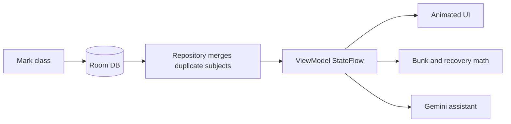

## 📲 Install in 60 seconds

1. Grab [`AttendTrack.apk`](AttendTrack.apk) from the project root, or build the debug APK yourself (see below).
2. Copy it to your phone and open it.
3. Allow **Install unknown apps** if asked. Done. 🎉

> Updating from an older build? Uninstall it (or clear its data) first, so old demo data doesn't linger.

## 🛠️ Build from source

**Needs:** a full **JDK 25** (the project's Gradle daemon requires it, and it must include `jlink`; a bare JRE won't work) and the Android SDK. Android Studio is optional and its bundled JBR works.

Point Gradle at your SDK with a `local.properties` file in the project root (it is git-ignored), or set `ANDROID_HOME`:

```properties
sdk.dir=C\:\\Users\\<you>\\AppData\\Local\\Android\\Sdk
```

```bash
git clone https://github.com/RajdipDhar2007/AttendTrack.git
cd AttendTrack
```

<details>
<summary><b>Option A: Android Studio</b></summary>

Open the folder, let Gradle sync, press ▶ Run.

</details>

<details>
<summary><b>Option B: Command line (no Android Studio)</b></summary>

```powershell
$env:JAVA_HOME = "C:\Program Files\Android\Android Studio\jbr"   # any full JDK 25
$env:ANDROID_HOME = "$env:LOCALAPPDATA\Android\Sdk"                # or use local.properties
gradle assembleDebug
```

APK output: `app/build/outputs/apk/debug/app-debug.apk`

The debug build signs with `debug.keystore` in the project root. Create one if missing:

```bash
keytool -genkeypair -keystore debug.keystore -storepass android -keypass android \
  -alias androiddebugkey -keyalg RSA -keysize 2048 -validity 10000 \
  -dname "CN=Android Debug,O=Android,C=US"
```

</details>

<details>
<summary><b>🔑 Gemini API key (optional, enables the AI Assistant)</b></summary>

Copy `.env.example` to `.env`:

```text
GEMINI_API_KEY=your_key_here
```

You can also paste a key inside the app's settings. Never commit `.env` or real keystores.

</details>

## 🗂️ Project structure

```text
.
├── AttendTrack.apk               Ready-to-install debug build
├── Rajdip_Dhar_Schedule.json     Sample timetable for the JSON import
├── docs/
│   ├── banner.svg                Animated README header
│   ├── footer.svg                Animated README footer
│   └── screenshots/              App screenshots used above (see its README for the file list)
└── app/src/main/java/com/example/
    ├── data/         Room entities, DAO, repository, Gemini and backup services
    ├── receiver/     Alarms, boot and notification action receivers
    └── ui/
        ├── components/   GlassCard, Interactions (animations), charts, dialogs
        ├── navigation/   Nav graph and routes
        ├── screens/      Dashboard, Monthly, Bunk, Timetable, Exams, Study, AI, Settings
        ├── theme/        Palettes and typography
        └── viewmodel/    AttendTrackViewModel
```

## 🗺️ Roadmap

- [ ] Home-screen widget
- [ ] Animations on every screen
- [ ] Attendance export to PDF
- [ ] Multi-semester history

## 🤝 Contributing

Fork → branch → commit → pull request. Issues and ideas are very welcome.

## 👤 Author

**Rajdip Dhar** · [@RajdipDhar2007](https://github.com/RajdipDhar2007)

<div align="center">

<a href="https://github.com/RajdipDhar2007/AttendTrack">
  
</a>

<br/>


</div>
